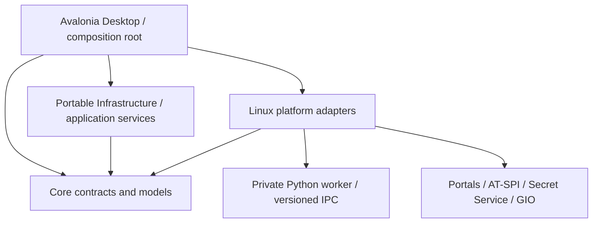

# Linux-first target architecture — Phase 1 proposal

Audit date: 2026-11-21, Asia/Karachi. Status: **proposed, not implemented**. Phase 2 requires user approval. Read alongside [the audit](../migration/PHASE-1-AUDIT.md), [roadmap](../migration/PHASE-ROADMAP.md), and [test report](../migration/PHASE-1-TEST-REPORT.md).

## Decision and alternatives

Preserve the existing assistant, tool registry/router, policy model, project/workspace services, bounded retrieval, and result/cancellation semantics. Separate platform mechanisms from those services; replace the presentation in increments. A different UI alone cannot make Windows UIA, filesystem handle checks, input hooks, Credential Manager, and authenticated pipe operations work on Linux.

Three approaches were evaluated:

| Approach | Benefit | Cost / decision |
| --- | --- | --- |
| Retarget the WPF/Infrastructure projects and add runtime OS branches | Few initial moves | WPF cannot run on Linux; Windows references remain in the dependency graph. Reject. |
| Extract existing portable services, introduce one Linux adapter project and an Avalonia host | Preserves behavior and makes native boundaries testable | Requires careful identity/path/security changes. **Recommended proposal**, not a user-approved implementation decision. |
| Immediately create all six proposed shared/platform projects and rewrite implementations | Explicit layering on paper | Large unverified move, duplicate services and regression risk. Defer additional splits until they enforce a demonstrated boundary. |

## Minimal project structure

Keep existing names and folders where useful. The following is an eventual ownership map, not a move performed in this phase:

```text
src/
  DesktopAgent.Core/              # existing net10.0 contracts, models, pure algorithms
  DesktopAgent.Infrastructure/    # existing reusable I/O/provider/persistence services, net10.0 after extraction
  DesktopAgent.Platform.Linux/    # new Linux mechanisms, later phases
  DesktopAgent.Desktop/           # new Avalonia host + MVVM, Phase 2 after approval
  DesktopAgent.App/               # original WPF source preserved, excluded from Linux build entry
  DesktopAgent.DevHook/           # original Windows relay preserved; no Linux registration yet
  DesktopAgent.PythonWorker/      # original Windows worker preserved
workers/linux-computer-use/       # later Linux backend; share protocol rather than copy an orchestrator
tests/
  DesktopAgent.Tests/             # retain Windows harness and fixtures
  DesktopAgent.Core.Tests/        # portable behavioral tests, extracted from existing cases
  DesktopAgent.Linux.Tests/       # explicit real-session tests, later
packaging/linux/                  # later desktop entry, icon, packaging manifests
docs/{architecture,migration,diagnostics}/
```

Core, portable Infrastructure, Linux adapters and Avalonia Desktop are sufficient production projects initially. Keep platform interfaces in Core for now; a dedicated `Platform.Abstractions` assembly adds little while Core has no native dependencies. `Application` becomes worthwhile only when orchestration can be moved once, with clear ownership and no duplicate service registrations. An `Application.Tests` project should follow that split, rather than precede it. Infrastructure is a current historical name; portable application services can remain in separate namespaces there during extraction. Do not create a second conversation manager/router just to match a folder diagram.

The existing WPF host depends on the current monolithic Infrastructure. When extracting Windows files, preserve them under a legacy source directory excluded from the Linux compilation graph, and preserve the existing Windows compilation graph/project references while adding the Linux graph. This reuses existing implementations; it does not authorize new Windows features or certify a Windows build without running it. Do not compile two copies of a service into the same active dependency graph. A separately buildable Windows platform project is a future decision; implementing it is outside this migration.

## Dependency rules



Core and application logic must not reference Avalonia, WPF, Win32, GNOME, D-Bus types, portal objects, or Python implementation classes. Linux must not need a concrete shared orchestration service: move any common transport/utility contract to Core rather than introduce a cycle. The composition root creates one instance per existing singleton service and one active backend per action. Views depend on ViewModels/application contracts. Native session objects and file descriptors stay in Linux/worker adapters.

The current Core compiles on Linux but is not conceptually platform-neutral: `IWin32WindowProbe`, `IWindowsUiAutomationService`, HWND-like numeric handles, UIA runtime integer arrays, Windows friendly names, and executable aliases leak Windows semantics. Generalize these deliberately while preserving old serialized fields for explicit import. Do not map a Wayland surface or AT-SPI object path into a fake HWND.

## Contract evolution

Reuse existing interfaces wherever their semantics remain sound. Names below marked new are proposals, not implemented APIs.

| Contract / seam | Keep or evolve | Linux responsibility and failure semantics |
| --- | --- | --- |
| `IAiProvider`, `IAiConnectionService`, `IAssistantConversationService`, `IAgentToolRouter`, `IAgentTool` | Keep | Existing streaming/tool planning stays in C#. Provider has no desktop authority. |
| `IPolicyService`, `IAgentActionApprovalService` | Keep | Pure policy and capability definitions; Avalonia renders a nonblocking cancellable approval. Portal consent remains a separate OS grant. |
| `IApplicationDiscoveryProvider`, `IApplicationCatalogRepository`, `IApplicationCatalog` | Keep/evolve launch metadata | XDG desktop-entry IDs and typed launch descriptors replace `.exe`/AUMID assumptions; preserve favorites and ambiguity handling. |
| `IApplicationControlService`, `IExecutableLocator`, `IShellService`, `IProjectEditorLauncher` | Keep intent, evolve results | GIO/desktop entries or explicit executable arguments; no shell interpolation. Process creation is not proof of a visible/focused application. |
| `IExternalWindowService`, `IMonitorService`, `IWindowService` | Separate external desktop authority from own-window UI | Monitor units explicit; external list/activate/move/resize return Unsupported when unavailable. Own-window service belongs to presentation. |
| `IWin32WindowProbe`, `IWindowsUiAutomationService` | Replace Windows-shaped contracts once with neutral observation/target services | Opaque provider/session-scoped window and element IDs, PID/start identity where available, capability-qualified focus evidence, fresh snapshots and stale-reference failure. |
| `IComputerInteractionBackend`, `IComputerActionExecutor` | Preserve preparation/execution and verification semantics | Adapter-specific identity stays opaque. Retain one-backend selection, no retry after possible mutation, and verified vs unverified outcomes. |
| `ICredentialStore`, `IStartupService` | Keep | Secret Service, explicit XDG autostart; unavailable/locked keyring means user action required, never plaintext fallback. |
| New `IAppPaths` | Add one shared path resolver contract | Absolute XDG roots, tested defaults, no repeated LocalApplicationData calculations. |
| New physical project-file access seam | Extract from `ProjectPathGuard` | Linux directory-relative handle operations, no-follow/containment/race protections, explicit mount/link policy. Preserve redaction and read budgets. |
| New desktop capability/safety contracts | Add only for actual consumers | Distinguish advertised, granted, ready and unsupported operations; source, reason and expiry accompany capability evidence. |
| Developer local transport/authentication seam | Extract from pipe protocol/server/relay | Per-user/session endpoint, peer credentials, bounded framed payloads, same cancellation and single-use approval semantics. |

Do not reduce security checks to string `StartsWith` or silently enable an action because an interface exists. Use native Linux path case semantics; application display-name matching can remain case-insensitive. Existing policy defaults and user Deny rules must survive.

## AI and application flow

The planner already exists as the bounded model/tool loop in `AssistantConversationService`; there is no separate planner service to replace. Keep the OpenAI-compatible HTTP/SSE provider, endpoint-scoped credential targets, no redirects, model/tool validation, direct-command fast path, structured references, complete-turn history trimming, source retrieval budgets and untrusted-data defenses.

Execution remains: human request → conversation gate/context → direct command or provider → validated typed tool → prepare stable target and derived capabilities → Allow/Ask/Deny → recheck policy/target after approval → one execution backend → verify result → actual activity/result cards → next bounded planning step. Capability filtering must agree with execution-time checks: unsupported Linux tools must not be advertised as available. Phase 5 means validating the preserved provider with Linux services, not postponing or replacing AI architecture until then.

`Stop()` cancels the active provider/tool/workspace/Computer Use scope and observation where supported. A native call may remain blocked; a private worker watchdog provides the hard boundary. Completed actions are not undone. Never restart and replay a mutation on timeout or child failure. Developer tools are independent sessions: assistant STOP does not kill unrelated coding agents or approve their requests.

Before the Secret Service adapter is delivered in Phase 3, Phase 2 composition must explicitly report credential storage unavailable and suppress cloud requests; a saved model/base URL is not a working connection. Use scripted providers only in an explicit test/preview composition, and never silently fall back to plaintext credentials.

Full/compact chat must share the same conversation instance. History is currently in memory only; preserve that behavior. Persistent transcripts would be a separate product/data decision, not migration repair.

## Linux platform design

Application discovery reads `$XDG_DATA_HOME/applications` and `$XDG_DATA_DIRS/*/applications`, respecting desktop-entry precedence, Hidden/NoDisplay/TryExec/OnlyShowIn/NotShowIn and safe `Exec` field expansion. Flatpak/Snap exports require real-session tests. Desktop entries are executable launch configuration, never arbitrary source to trust. Preserve metadata/search/deduplication and partial discovery outcomes; do not equate package inventory with launchable GUI apps.

Use explicit GIO/portal opening for files/folders/HTTP(S) URLs and desktop-entry launching; chosen bindings/library are an implementation decision. Keep `ProcessStartInfo.ArgumentList` for known editor executables. Reassess Linux executable/script/`.desktop` MIME policy; the Windows extension blacklist is insufficient. Do not emulate arbitrary Win32 window operations with process enumeration. GNOME-specific APIs, if approved later, are isolated optional adapters with explicit Unsupported behavior outside that compositor.

Notifications use the available desktop notification/portal service; tray visibility depends on StatusNotifierItem support. Startup is opt-in and packaging-aware. Global shortcuts require portal/compositor capability checks and user consent where applicable. Do not substitute privileged input devices, a Shell extension, or X11 automation for missing Wayland authority without a separate explicit decision.

## Avalonia backend decision

Research on 2026-11-21 found **12.1.6** as the latest GitHub release. Retain `net10.0`: the documented desktop minimum is .NET 8, compatible with the installed .NET 10 SDK. Pin matching Avalonia packages when Phase 2 is approved; no packages were installed here. [Release](https://github.com/AvaloniaUI/Avalonia/releases/tag/12.1.6), [.NET requirements](https://docs.avaloniaui.net/docs/overview/supported-platforms).

Recommend a native-Wayland-first qualification using `Avalonia.Wayland`/`UseWayland()`. Default platform detection still uses X11/XWayland, and the native backend is early-stage. Record the selected backend; fail clearly if native initialization fails. An explicitly selected XWayland compatibility mode may be offered later, but cannot count as native acceptance. [Linux backend documentation](https://docs.avaloniaui.net/docs/platform-specific-guides/linux).

Keyboard, clipboard and basic window behavior need target-machine verification. Treat transparency, frameless dragging, topmost, position restoration, tray integration and accessibility as separate acceptance items. Compositor constraints prevent promising the existing unrestricted floating companion positioning/stacking. Phase 2 should retain a normal usable main window even when companion capabilities are unavailable. No visual/product redesign is authorized by this proposal.

## Linux Python worker design (Phase 4)

Keep Python for low-level execution/observation. Reuse the strict request validator, private child lifecycle, one-action serialization, redacted diagnostics and semantic result states. Preserve the Windows worker in place; factor shared protocol code only when a Linux implementation exists. No AI provider, prompts, autonomous planning, policy storage or credential access belongs in the worker.

Proposed handshake adds protocol version, backend version and advertised capabilities. Requests contain unique ID, action, opaque prepared target/snapshot reference, bounded arguments and deadline. Responses use a strict schema with matching ID, status, verification evidence, whether input may have been dispatched, and sanitized error. Reject unknown/duplicate fields, oversized lines, invalid types and incompatible versions on both sides. Treat timeout/EOF/malformed response as uncertain execution for mutations. Handle a queued request's timeout as well as the execution deadline.

Use inherited private stdin/stdout NDJSON initially, not an open TCP service. Parent owns the child process, validates its configured absolute interpreter and installed dependencies, drains stderr without sensitive content, kills only its child on deadline/STOP, releases held inputs, and never automatically retries. If Unix sockets become necessary for developer events or descriptor transfer, use restrictive `$XDG_RUNTIME_DIR` endpoints plus OS peer authentication; do not weaken existing SID/PID checks by dropping authentication.

For accessibility, prefer the available `gi.repository.Atspi` and distro PyGObject bindings; ordinary venvs may hide them, so interpreter packaging needs explicit tests. D-Bus binding choice must support asynchronous requests and Unix descriptors. ScreenCast uses granted PipeWire streams; input uses an authorized RemoteDesktop session, with libei/EIS only where negotiated. Define which process owns the portal session/descriptors and close everything on STOP/revocation; default recommendation is worker ownership of observation/input sessions with the parent supplying a valid portal parent-window identifier and retaining the kill boundary. C# must not create a second competing capture/input session.

Pin identity to AT-SPI bus/object identity plus application/process/session metadata, snapshot generation, expiry, target control state and focus evidence. Handle disappearing objects and process reuse. Accessibility trees are incomplete and untrusted; password/private fields are excluded, ordinary values remain bounded/redacted, and cloud export uses the existing small context budget. AT-SPI actions do not grant unrestricted Wayland input or window activation.

Do not enable mutation if visible STOP, revocation, focus/target validation, user takeover behavior and uncertainty handling cannot be demonstrated. A global Win32 input-presence hook has no direct Wayland equivalent. Until an approved mechanism provides sufficient safety, observation can be available while mutation remains unavailable.

## Data preservation and extension strategy

Inject XDG paths; keep existing JSON schemas/IDs and offer a future explicit copy-based import with a preview, backup, validation and rollback. No data changes occur in Phase 1. Keep Windows application IDs/paths as unresolved imported metadata rather than executing or guessing conversions. Credentials require explicit re-entry or an approved secure transfer; Credential Manager blobs are not Linux secrets. See the audit's data inventory.

Future Windows adapters implement these same contracts, preserving existing source and invariants. Register exactly one OS adapter family in the host; shared AI/policy/business logic remains identical. No Windows implementation is added now. Each later extraction must retain tests and an auditable old-to-new ownership map; delete nothing merely because a file says Windows.
